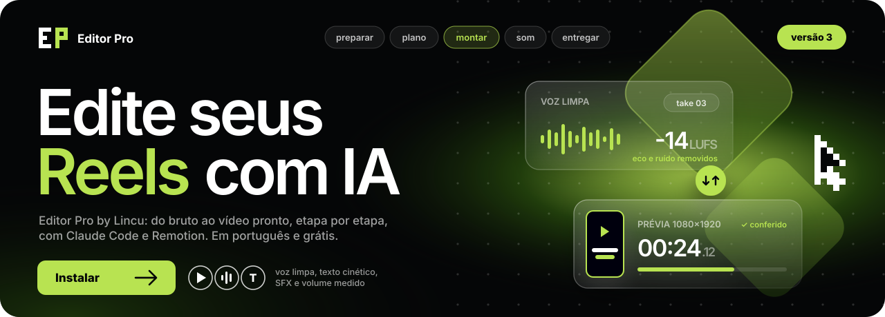

<p align="center">
  
</p>

<p align="center">
  
  
  
  
  
</p>

<p align="center"><b>Você manda os brutos e pede “edita esse vídeo”. Ele entrega o Reels pronto.</b></p>

---

## Instale em 1 passo

Cole o link no chat do Claude Code e escreva **instala isso**:

```
https://github.com/lincolnribs/editor-pro-bylincu
```

Depois, reinicie o Claude Code. Não precisa de conta no GitHub.

## O que ele faz

| Recurso | Como funciona |
|---|---|
| 🎙️ **Voz limpa** | Tira eco, ruído e pancadas (DeepFilterNet, local) e corta os silêncios. |
| ✂️ **Cortes que não pulam** | Decupagem dos takes, punch-in alternado e cor corrigida take a take. |
| 🔤 **Lettering cinético** | Texto palavra a palavra, no ritmo da fala, sempre longe do rosto e dentro das margens do Reels. |
| 🔊 **Som no ponto** | SFX e trilha do Mixkit, com volume medido (voz a -14 LUFS). |
| 🗂️ **Tudo organizado** | Cria pastas de estúdio, efeitos, músicas e uma por cliente, com a identidade de cada um. |
| ⚡ **Ativa sozinho** | Reconhece pedidos de edição de vídeo e entra em ação, sem precisar chamar. |
| 📉 **Gasta pouco** | Scripts que resumem logs, transcrições e imagens: o Claude lê uma linha, não mil. |

## Como funciona

O Claude analisa o material e o pedido, escolhe o **formato** e segue o caminho certo para ele. Cada etapa é um comando que já diz qual é a próxima: o Claude não planeja nem escreve código, só decide o que é criativo.

| Formato | Para quê | O caminho |
|---|---|---|
| 🎙️ **Talking head** | Reels premium com pessoa falando | decupagem → voz limpa → lettering, b-roll, SFX → prévia → entrega |
| 💰 **Comercial** | Anúncio, oferta, lançamento | talking head + gancho, prova, oferta, CTA e fechamento com a marca |
| ✂️ **Decupagem** | Só montar os takes | melhores trechos → voz e silêncios → legenda simples |
| 💬 **Legenda** | Vídeo já editado | voz limpa sem cortar → legenda revisada |
| 🎉 **Aftermovie** | Evento, bastidores, sem fala | música → seleção dos clipes → cortes na batida → título e fechamento |
| ✨ **Motion** | Vinheta, logo, peça animada | o complemento certo para o pedido → entrega registrada |

## Complementos incluídos

Nove skills de motion escolhidas entre 526 de um catálogo com nota de segurança. Já vêm no pacote, todas grátis para uso comercial, e o Editor Pro chama cada uma quando o vídeo pede.

| Para | Complemento | Licença |
|---|---|---|
| Efeitos sobre a pessoa (texto atrás da cabeça) | [claude-video-effects](https://github.com/Vibha-Ramprakash/claude-video-effects) | MIT |
| Diretor de motion com crítico | [remotion-director](https://github.com/Zane-0x5a/remotion-director) | MIT |
| Lettering no ritmo da música | [kinetic-typography](https://github.com/iart-ai/kinetic-typography-skills) | MIT |
| Aberturas e bumpers 9:16 | [bang-motion](https://github.com/bangtutorial/bang-motion) | MIT |
| Motion sem cara de IA | [motionmaxxing](https://github.com/Tejashmakwana/motionmaxxing) | Apache-2.0 |
| Comercial premium com rodadas de crítica | [motion-video-kit](https://github.com/echris6/motion-video-kit) | MIT |
| Motion contínuo, sem corte, na batida | [product-launch-motion](https://github.com/AbubakrChan/product-launch-motion) | MIT |
| Logo animado | [pixel2motion](https://github.com/nolangz/pixel2motion) | MIT |
| Ícones animados | [lottie](https://github.com/diffusionstudio/lottie) | MIT |

<sub>Créditos e versões em <a href="THIRD_PARTY_NOTICES.md">THIRD_PARTY_NOTICES.md</a>.</sub>

## Perguntas rápidas

<details>
<summary><b>Do que eu preciso no computador?</b></summary>

Node.js 18+, Python 3.10+, ffmpeg e o DeepFilterNet 0.5.6. O Claude confere o que falta e instala com a sua permissão.
</details>

<details>
<summary><b>Funciona no Windows?</b></summary>

Sim. Foi feito e testado no Windows, e também roda em macOS e Linux.
</details>

<details>
<summary><b>Posso usar em vídeos de clientes?</b></summary>

Sim. Tudo no pacote é grátis para uso comercial, complementos incluídos. Só o Remotion tem uma regra: é grátis para uso individual e para empresas pequenas, e empresas maiores precisam de [licença](https://www.remotion.dev/license).
</details>

<details>
<summary><b>Como atualizo?</b></summary>

`/plugin marketplace update bylincu`
</details>

<details>
<summary><b>Instalação manual</b></summary>

```
/plugin marketplace add lincolnribs/editor-pro-bylincu
/plugin install editor-pro-bylincu@bylincu
/plugin install remotion@bylincu
/plugin install remotion-director@bylincu
```
No terminal, troque `/plugin` por `claude plugin`. Para chamar direto: `/editor-pro-bylincu`.
</details>

<details>
<summary><b>Instruções para o Claude (instalação automática)</b></summary>

Se o usuário te mandou este link pedindo para instalar, explique cada passo em uma linha e peça permissão antes de baixar ou instalar programas.

1. Rode no terminal: `claude plugin marketplace add lincolnribs/editor-pro-bylincu`, `claude plugin install editor-pro-bylincu@bylincu`, `claude plugin install remotion@bylincu` e `claude plugin install remotion-director@bylincu`.
2. Sem o comando `claude`: peça ao usuário para digitar no chat os mesmos comandos com `/plugin` no lugar de `claude plugin`. Sem `/plugin`: faça `git clone --depth 1` deste repositório numa pasta temporária e copie as pastas de `plugins/editor-pro-bylincu/skills/` para `~/.claude/skills/` (fica sem a ativação automática).
3. Confira Node.js, Python, ffmpeg e DeepFilterNet seguindo `plugins/editor-pro-bylincu/skills/editor-pro-bylincu/references/instalacao.md`. Instale só o que faltar, com permissão (no Windows, prefira `winget`).
4. Peça para reiniciar o Claude Code e depois mandar o vídeo com **edita esse vídeo**.
</details>

---

<sub>Catálogo de skills adaptado do <a href="https://github.com/zhuyansen/awesome-claude-video-skills">Awesome Claude Video Skills</a> (CC0). Cada projeto listado tem a própria licença. Mixkit: uso comercial grátis. DeepFilterNet: MIT/Apache-2.0.</sub>
